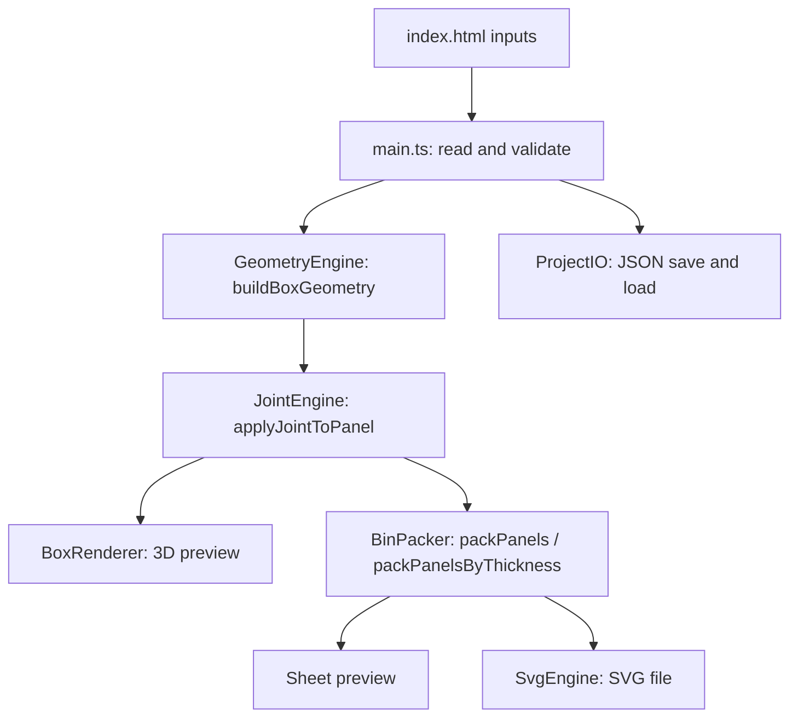

# Web-Based Box Maker

A browser-based tool that turns a few parameters (box size, material thickness, kerf, dividers, lid) into a **ready-to-cut, finger-jointed laser-cutting layout**. It shows the box in 3D, packs the flat panels onto a sheet, and exports a standard SVG.

Everything runs in the browser. There is no server, no database and no account.

**Author:** Ferhat Göksel

---

## Contents

1. [Features](#features)
2. [Quick start](#quick-start)
3. [Using the application](#using-the-application)
4. [Project structure](#project-structure)
5. [Architecture](#architecture)
6. [How the algorithms work](#how-the-algorithms-work)
7. [Project file format (JSON)](#project-file-format-json)
8. [Validation](#validation)
9. [Testing](#testing)
10. [Development phases](#development-phases)
11. [Known limitations and further work](#known-limitations-and-further-work)

---

## Features

| Area | What it does |
|---|---|
| Parametric box | Width, depth and height, with separate frame, base and divider thicknesses and a kerf value. |
| Finger joints | Walls, base and lid are cut with tabs and matching slots that fit together. Finger width adapts to the edge length and material thickness. |
| Dividers | A grid of column and row dividers, optionally lower than the walls. The compartments are either equal or have exact sizes that you type in, and the box can be sized to fit them. Dividers cross-halve (interlock) at every crossing. |
| Lid | Optional lid built the same way as the tray, with a clearance tolerance. |
| 3D preview | Rotatable, zoomable model with numbered parts. Wireframe, explode and reset-camera controls. Clicking a part in the list highlights it. |
| Sheet layout | Panels are packed onto A4, A3, A2, A1 or a custom sheet size, with a configurable gap. Overflowing panels are reported. Panels can optionally be grouped by material thickness. |
| SVG export | Cut paths with part numbers, redundant points removed, kerf compensation applied. |
| Save and load | The whole design is saved to and loaded from a JSON file. |
| Live update | Once a box has been generated, changing a value rebuilds the model (and the sheet layout) automatically after a short pause. This can be switched off. |
| Validation | Invalid input is rejected with a message and a highlighted field. |

---

## Quick start

You need **Node.js 20 or newer**.

```bash
npm install      # install dependencies (once)
npm run dev      # start the app, then open the printed address (http://localhost:5173)
npm test         # run the automated tests
npm run build    # type-check and build a static version into dist/
```

The build output in `dist/` is a plain static website that can be hosted anywhere.

---

## Using the application

1. **Enter the parameters** in the left panel: box dimensions, material thicknesses, kerf, joint style, and the optional lid and dividers.
2. **Generate** builds the panels and shows the 3D model.
3. Use **Wireframe**, **Explode** and **Reset Camera** to inspect the model. Click a part in the list on the right to highlight it.
4. Choose a **sheet size** (or *Custom size* with its own width and height) and a gap in the right panel, then run **Bin Packing**. Switch to **Sheet Layout** to see the arrangement and the sheet efficiency.
5. Turn on **Separate by Thickness** if you cut different thicknesses from different sheets.
6. **Export SVG** to get the cut file.
7. **Export JSON** saves the design. **Import JSON** loads one back.

**Compartment sizes.** With dividers on, leave *Column Widths* and *Row Depths* empty for equal compartments, or type exact sizes such as `40, 30, 50` (columns run left to right, rows back to front). The sizes plus the divider thicknesses must add up to the inside of the box. If they don't, the message says what inside size is needed, and **Fit box size to compartments** sets the box width and depth for you. A small summary under the fields lists the resulting compartment sizes.

Changing a value after the first **Generate** updates the model automatically (switch *Update automatically* off to disable this). **Reset to defaults** restores the starting values. *Finger Width* sets a fixed finger width instead of the automatic one. On a narrow screen the three columns stack and the page scrolls.

All measurements are in millimetres.

Default values: 120 × 90 × 55 mm box, 3 mm material, 0.1 mm kerf, 3 fingers per edge, A3 sheet, 2 mm gap.

---

## Project structure

```
index.html                  UI layout and element IDs
src/
  main.ts                   UI controller: events, validation, orchestration
  models/types.ts           Shared data types (BoxParams, Panel, JointPlan, SheetLayout, ...)
  geometry/
    GeometryEngine.ts       Builds all panels and their joint plans
    JointEngine.ts          Turns joint plans into cut outlines
    outline.ts              Polygon helpers: clean-up, offset, bounds
  rendering/BoxRenderer.ts  Three.js 3D preview
  svg/
    BinPacker.ts            Sheet packing and the 2D preview
    SvgEngine.ts            SVG generation and download
  utils/ProjectIO.ts        Default values, JSON export and import
  ui/style.css              Styling
  __tests__/                Automated tests
```

---

## Architecture

The application has three layers that talk through plain function calls and shared data structures. The central data type is `Panel`: the 3D renderer, the packer and the SVG engine all consume it.

| Layer | Modules | Role |
|---|---|---|
| User interface | `index.html`, `main.ts`, `style.css` | Collects parameters, validates them, triggers generation. |
| Logic and geometry | `GeometryEngine`, `JointEngine`, `outline`, `BinPacker` | Calculates panels, joints and the sheet layout. |
| Rendering and export | `BoxRenderer`, `SvgEngine`, `ProjectIO` | Draws the 3D model, writes SVG and JSON. |

### Data flow



1. The controller reads the inputs into a `BoxParams` object and validates it.
2. `buildBoxGeometry` creates the list of panels, each with a plain rectangle, its position in 3D, and a **joint plan** that says which edge mates with which neighbour.
3. `applyJointToPanel` replaces each rectangle with the real cut outline.
4. The same panels feed the 3D renderer and the packer. The packer's layout feeds both the sheet preview and the SVG export.

Panel outlines are ordered 2D points. Any change the joint engine makes to an outline therefore shows up in the 3D model, the sheet preview and the SVG at the same time.

---

## How the algorithms work

### 1. Geometry (`GeometryEngine`)

With external size `W × D × H`, frame thickness `tF` and base thickness `tB`:

- internal width `iW = W − 2·tF`
- internal depth `iD = D − 2·tF`
- internal height `iH = H − tB`

The engine creates these panels, each with a sequence number, group (`tray`, `lid`, `divider`), 3D position and rotation:

| Panel | Size |
|---|---|
| Bottom | `W × D`, thickness `tB` |
| Front and back walls | `iW × iH`, thickness `tF` |
| Left and right walls | `D × iH`, thickness `tF` |
| Lid (optional) | the same five panels, using the lid size and height |
| Column and row dividers (optional) | `iD × h` and `iW × h`, thickness `tD`, where `h` is the divider height |

In 3D, everything sits on a grounded coordinate system: the underside of the bottom panel is at `y = 0`, so toggling the lid or dividers never makes parts float.

### 2. Joints (`JointEngine`)

Each panel carries a **joint plan**: for each of its four edges, whether it gets *tabs* (fingers sticking out), *slots* (notches cut in), *notches* at chosen positions, or stays flat. The geometry engine decides what mates with what; the joint engine decides the finger layout.

- Walls stand on the base plate. Their bottom tabs drop into slots in the plate.
- Front and back walls push tabs through the ends of the left and right walls.
- Dividers cross-halve: where a column and a row divider cross, the column divider is slotted from the top and the row divider from the bottom, each by half the divider height, so they slide together.

**Finger sizing.** An edge is split into `2·count − 1` equal segments, alternating tab, gap, ..., tab. The pattern is symmetric, so two mating edges line up whichever way they are walked. A finger is never narrower than `1.5 × thickness`; if the requested count would make fingers narrower, the count is reduced. A fixed finger width can be given instead of a count.

**Outline building.** The outline is walked counter-clockwise around the panel, adding the tab or slot points for each edge. Duplicate points, zero-width spikes and collinear points are then removed. Finally the outline is moved so its bounding box starts at `(0, 0)`, and the original rectangle is remembered as the panel's `body` so the 3D mesh is centred correctly.

**Joint styles.** `finger` and `box` produce finger joints. `none` (shown as *Flat*) leaves plain rectangles, but divider cross slots are kept because the dividers could not fit together without them.

### 3. Kerf compensation (`SvgEngine`)

A laser removes about `kerf / 2` of material on each side of the cut line. At export, every cut path is therefore pushed outward by `kerf / 2`: tabs get slightly wider and slots slightly narrower, so that after cutting a tab fits its slot. The 3D preview shows the nominal geometry.

### 4. Sheet packing (`BinPacker`)

Panels are packed as rectangles (their outline bounding boxes) with optional 90° rotation, using a free-rectangle method:

1. Sort panels by area, largest first.
2. Keep a list of free rectangles, starting with the whole sheet minus the gap.
3. For each panel, score every free rectangle in both orientations. A tight fit that leaves little wasted area scores best, with a small preference for a smaller leftover short side.
4. Place the panel in the best rectangle and split the rest with a guillotine split (along the width first or the height first, whichever leaves the larger remainder).
5. Remove free rectangles that are fully contained in another one.

Because panels are only ever placed inside free rectangles, they cannot overlap. A panel that fits nowhere is marked `overflow` and is left out of the SVG, with a comment listing it. **Separate by Thickness** packs each thickness group onto its own sheet section.

Sheet efficiency is the used panel area divided by the sheet area.

### 5. SVG export (`SvgEngine`)

Each placed outline is rotated if needed, kerf-compensated, and written as an SVG path using `H` and `V` commands for straight segments. Collinear points are removed and paths are merged by colour, which keeps the file small. Each panel gets its sequence number and name as a label. The grouped export stacks the thickness groups in one document.

---

## Project file format (JSON)

```json
{
  "meta": { "app": "Web-Based Box Maker", "version": "1.0.0", "author": "...", "created": "...", "modified": "..." },
  "params": {
    "width": 120, "depth": 90, "height": 55,
    "material": { "frameThickness": 3, "baseThickness": 3, "dividerThickness": 3, "kerf": 0.1 },
    "joint":   { "style": "finger", "minTabCount": 3, "tabWidthOverride": 0 },
    "divider": { "enabled": false, "columns": 2, "rows": 2, "columnWidths": [], "rowDepths": [], "heightOverride": 0 },
    "lid":     { "enabled": false, "height": 12, "tolerance": 0.2 },
    "label":   { "enabled": false, "text": "", "face": "front", "fontSize": 8 }
  },
  "sheet": { "size": "A3", "width": 420, "height": 297, "gap": 2 }
}
```

The file contains data only, never code. Importing restores the parameters and the sheet settings.

When a file is imported, every field is checked (see [Validation](#validation)). Only the checked values are copied into the application; unknown fields are ignored and reported.

---

## Validation

The controller rejects a design before generating when:

- width, depth, height or any thickness is not greater than zero
- kerf is negative
- the tab count, divider columns or divider rows are not whole numbers of at least 1
- the walls would leave no interior (width or depth `≤ 2·tF`, or height `≤ tB`)
- the lid is not taller than the base thickness
- the dividers do not fit (a compartment would have zero or negative size, or typed compartment sizes do not add up to the inside of the box) or are taller than the interior

Invalid fields are highlighted and the reason is shown.

### Importing a JSON file

An imported file is validated field by field before anything is applied. All problems are collected and listed together, each naming the exact field, for example `params.material.kerf is missing` or `params.joint.style must be one of finger, box, dovetail, none (got "zigzag")`.

- **Structure:** the file must be a JSON object with a `params` object. Empty, broken or oversized input (over 1 MB) is rejected.
- **Types:** numbers must be real numbers (JSON `null`, text and `NaN`-like values are rejected), flags must be `true` or `false`, and each section must be an object.
- **Ranges:** dimensions and thicknesses must be greater than zero and not absurdly large, kerf and tolerance cannot be negative, counts must be whole numbers, and the joint style, label face and sheet size must be known values.
- **Buildable:** the walls must leave room inside the box, a lid must be taller than the base thickness, and divider grids must fit.
- **Missing optional sections** (`joint`, `divider`, `lid`, `label`, `sheet`) fall back to the default values, with a note. Fields that are not used are ignored, with a note.

---

## Testing

```bash
npm test
```

The tests cover:

- **Geometry:** internal dimensions, panel list, lid panels, grounding of the bottom and walls, dividers on the floor.
- **Joints:** tab sizing and minimum finger width, outlines without invalid numbers, normalisation, repeatable results, flat style, outline helpers, and the divider slot sizes.
- **Assembly:** the generated panels are placed in 3D and the whole volume is sampled. Every point of nominal material must be covered by exactly one panel, with no overlap, no gap and no stray tab. This is checked for the default box, different frame and base thicknesses, the lid, divider grids and lower dividers.
- **Project files:** valid files round-trip exactly, and unreadable input, wrong types, out-of-range values, boxes that cannot be built, unknown fields and a `__proto__` key are all handled.
- **Layout:** overflow detection, no overlapping panels, grouping by thickness.
- **SVG:** a valid document with paths, and the overflow comment.

The assembly tests take around ten seconds because they sample the volume.

---

## Development phases

1. Project setup and architecture (Vite, TypeScript, folder structure, core types)
2. Geometry engine (parametric panels, thickness handling)
3. Finger joints and dividers
4. 3D rendering with Three.js
5. SVG generation
6. SVG optimisation and sheet layout
7. JSON import and export
8. UI refinement and parameter validation
9. Testing and edge cases
10. Performance optimisation
11. Final integration and stability review
12. Documentation

After the first version, the joints were reworked so that mating edges are complementary and verified by the assembly tests, and the dividers were made to interlock.

---

## Known limitations and further work

- Dividers interlock with each other but are not fixed to the walls or the base plate, which would need slots in the middle of those panels.
- The `box` joint style currently behaves like `finger`.
- The `label` setting exists in the data model but is not available in the interface yet.
- Packing uses a single heuristic and is not guaranteed to be optimal. Comparing it with other packing methods is planned.
- Only rectangular boxes are supported.

---

## Technology

TypeScript, Vite, Three.js (3D), Vitest (tests). The interface is plain HTML and CSS. The geometry, joint, packing and SVG algorithms are written from scratch, with no CAD or SVG library.
