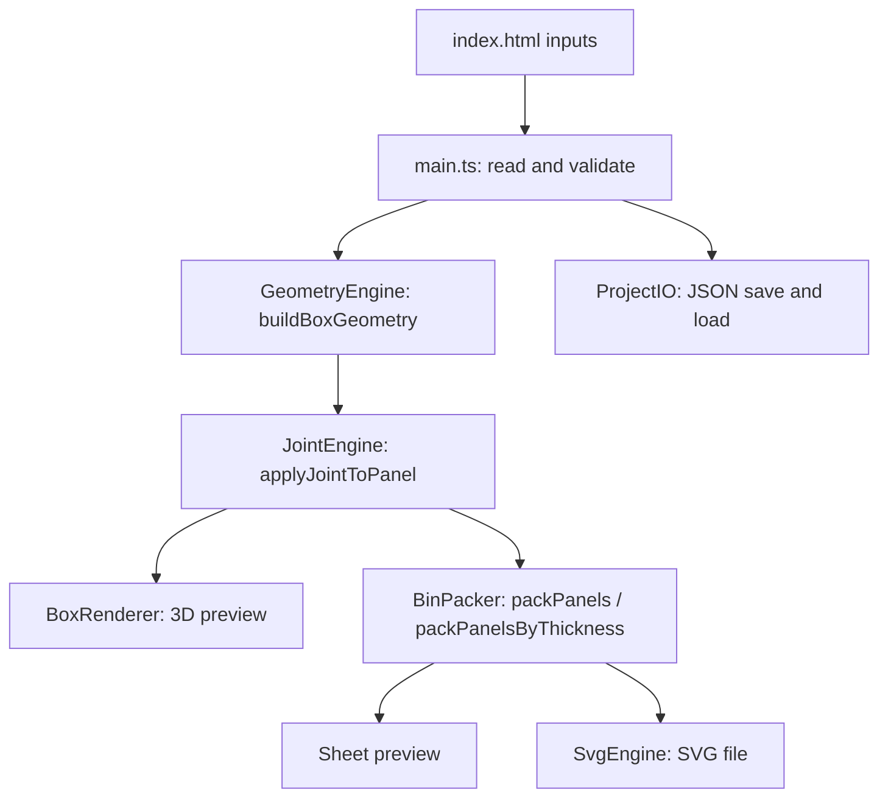

# Web-Based Box Maker

A browser-based tool that turns a few parameters (box size, material thickness, kerf, dividers, lid) into a **ready-to-cut, finger-jointed laser-cutting layout**. It shows the box in 3D, packs the flat panels onto a sheet, and exports a standard SVG.

Everything runs in the browser. There is no server, no database and no account.

**Author:** Ferhat Göksel

---

## Contents

1. [Features](#features)
2. [Quick start](#quick-start)
3. [Using the application](#using-the-application)
4. [Project structure](#project-structure)
5. [Architecture](#architecture)
6. [How the algorithms work](#how-the-algorithms-work)
7. [Project file format (JSON)](#project-file-format-json)
8. [Validation](#validation)
9. [Testing](#testing)
10. [Development phases](#development-phases)
11. [Known limitations and further work](#known-limitations-and-further-work)

---

## Features

| Area | What it does |
|---|---|
| Parametric box | Width, depth and height, with separate frame, base and divider thicknesses, a kerf value and a fit clearance. |
| Finger joints | Walls, base and lid are cut with tabs and matching slots that fit together. Finger width adapts to the edge length and material thickness. |
| Dividers | A grid of column and row dividers, optionally lower than the walls. The compartments are either equal or have exact sizes that you type in, and the box can be sized to fit them. Dividers cross-halve (interlock) at every crossing. |
| Lid | Optional lid built the same way as the tray, with a clearance tolerance. |
| 3D preview | Rotatable, zoomable model with numbered parts. Wireframe, explode and reset-camera controls. Clicking a part in the list highlights it. |
| Sheet layout | Panels are packed onto A4, A3, A2, A1 or a custom sheet size, with a configurable gap, using one of three packing methods (MaxRects, Skyline, Guillotine). Overflowing panels are reported. Panels can optionally be grouped by material thickness. |
| Engraved label | A line of text on any face (front, back, left, right, bottom or the lid top), shown on the 3D model and written to the SVG as a separate engrave layer. |
| SVG export | Cut paths with part numbers, redundant points removed, kerf compensation applied. |
| Save and load | The whole design is saved to and loaded from a JSON file. |
| Live update | Once a box has been generated, changing a value rebuilds the model (and the sheet layout) automatically after a short pause. This can be switched off. |
| Validation | Invalid input is rejected with a message and a highlighted field. |

---

## Quick start

You need **Node.js 20 or newer**.

```bash
npm install      # install dependencies (once)
npm run dev      # start the app, then open the printed address (http://localhost:5173)
npm test         # run the automated tests
npm run benchmark  # compare the packing methods on 300 random boxes
npm run build    # type-check and build a static version into dist/
```

The build output in `dist/` is a plain static website that can be hosted anywhere.

---

## Using the application

1. **Enter the parameters** in the left panel: box dimensions, material thicknesses, kerf, joint style, and the optional lid and dividers.
2. **Generate** builds the panels and shows the 3D model.
3. Use **Wireframe**, **Explode** and **Reset Camera** to inspect the model. Click a part in the list on the right to highlight it.
4. Choose a **sheet size** (or *Custom size* with its own width and height) and a gap in the right panel, pick a **packing method**, then run **Bin Packing**. Switch to **Sheet Layout** to see the arrangement and the sheet efficiency.
5. Turn on **Separate by Thickness** if you cut different thicknesses from different sheets.
6. **Export SVG** to get the cut file.
7. **Export JSON** saves the design. **Import JSON** loads one back.

**Engraved label.** Switch *Engrave Text* on, type the text, pick the face and the text height. The text is centred on that face and shown on the model. It is checked against the face: it must fit within 90% of the face width and height, and a label on the top needs the lid.

**Compartment sizes.** With dividers on, leave *Column Widths* and *Row Depths* empty for equal compartments, or type exact sizes such as `40, 30, 50` (columns run left to right, rows back to front). The sizes plus the divider thicknesses must add up to the inside of the box. If they don't, the message says what inside size is needed, and **Fit box size to compartments** sets the box width and depth for you. A small summary under the fields lists the resulting compartment sizes.

Changing a value after the first **Generate** updates the model automatically (switch *Update automatically* off to disable this). **Reset to defaults** restores the starting values. *Finger Width* sets a fixed finger width instead of the automatic one. On a narrow screen the three columns stack and the page scrolls.

All measurements are in millimetres.

Default values: 120 × 90 × 55 mm box, 3 mm material, 0.1 mm kerf, 3 fingers per edge, A3 sheet, 2 mm gap.

---

## Project structure

```
index.html                  UI layout and element IDs
src/
  main.ts                   UI controller: events, validation, orchestration
  models/types.ts           Shared data types (BoxParams, Panel, JointPlan, SheetLayout, ...)
  geometry/
    GeometryEngine.ts       Builds all panels and their joint plans
    JointEngine.ts          Turns joint plans into cut outlines
    outline.ts              Polygon helpers: clean-up, offset, bounds
    compartments.ts         Divider layout: equal or exact compartment sizes
    label.ts                Engraved label: which panel, fit checks
  rendering/BoxRenderer.ts  Three.js 3D preview
  svg/
    BinPacker.ts            Sheet packing and the 2D preview
    packers.ts              The three packing methods (MaxRects, Skyline, Guillotine)
    SvgEngine.ts            SVG generation and download
  utils/ProjectIO.ts        Default values, JSON export and import
  ui/style.css              Styling
  __tests__/                Automated tests
```

---

## Architecture

The application has three layers that talk through plain function calls and shared data structures. The central data type is `Panel`: the 3D renderer, the packer and the SVG engine all consume it.

| Layer | Modules | Role |
|---|---|---|
| User interface | `index.html`, `main.ts`, `style.css` | Collects parameters, validates them, triggers generation. |
| Logic and geometry | `GeometryEngine`, `JointEngine`, `outline`, `BinPacker` | Calculates panels, joints and the sheet layout. |
| Rendering and export | `BoxRenderer`, `SvgEngine`, `ProjectIO` | Draws the 3D model, writes SVG and JSON. |

### Data flow



1. The controller reads the inputs into a `BoxParams` object and validates it.
2. `buildBoxGeometry` creates the list of panels, each with a plain rectangle, its position in 3D, and a **joint plan** that says which edge mates with which neighbour.
3. `applyJointToPanel` replaces each rectangle with the real cut outline.
4. The same panels feed the 3D renderer and the packer. The packer's layout feeds both the sheet preview and the SVG export.

Panel outlines are ordered 2D points. Any change the joint engine makes to an outline therefore shows up in the 3D model, the sheet preview and the SVG at the same time.

---

## How the algorithms work

### 1. Geometry (`GeometryEngine`)

With external size `W × D × H`, frame thickness `tF` and base thickness `tB`:

- internal width `iW = W − 2·tF`
- internal depth `iD = D − 2·tF`
- internal height `iH = H − tB`

The engine creates these panels, each with a sequence number, group (`tray`, `lid`, `divider`), 3D position and rotation:

| Panel | Size |
|---|---|
| Bottom | `W × D`, thickness `tB` |
| Front and back walls | `iW × iH`, thickness `tF` |
| Left and right walls | `D × iH`, thickness `tF` |
| Lid (optional) | the same five panels, using the lid size and height |
| Column and row dividers (optional) | `iD × h` and `iW × h`, thickness `tD`, where `h` is the divider height |

In 3D, everything sits on a grounded coordinate system: the underside of the bottom panel is at `y = 0`, so toggling the lid or dividers never makes parts float.

### 2. Joints (`JointEngine`)

Each panel carries a **joint plan**: for each of its four edges, whether it gets *tabs* (fingers sticking out), *slots* (notches cut in), *notches* at chosen positions, or stays flat. The geometry engine decides what mates with what; the joint engine decides the finger layout.

- Walls stand on the base plate. Their bottom tabs drop into slots in the plate.
- Front and back walls push tabs through the ends of the left and right walls.
- Dividers cross-halve: where a column and a row divider cross, the column divider is slotted from the top and the row divider from the bottom, each by half the divider height, so they slide together.

**Finger sizing.** An edge is split into `2·count − 1` equal segments, alternating tab, gap, ..., tab. The pattern is symmetric, so two mating edges line up whichever way they are walked. A finger is never narrower than `1.5 × thickness`; if the requested count would make fingers narrower, the count is reduced. A fixed finger width can be given instead of a count.

**Outline building.** The outline is walked counter-clockwise around the panel, adding the tab or slot points for each edge. Duplicate points, zero-width spikes and collinear points are then removed. Finally the outline is moved so its bounding box starts at `(0, 0)`, and the original rectangle is remembered as the panel's `body` so the 3D mesh is centred correctly.

**Joint styles.** `finger` produces finger joints. `none` (shown as *Flat*) leaves plain rectangles, but divider cross slots are kept because the dividers could not fit together without them.

Other joints, such as dovetails, are deliberately not offered. A laser cuts straight through the sheet, so a joint can only be shaped in the plane of the panel. A dovetail on a box corner flares through the thickness of the board, which a 2D cut cannot produce, so the parts would look right on screen and not fit together. Older project files that say `box` (another name for finger joints) are read as `finger` with a note.

### 3. Kerf compensation and fit clearance (`SvgEngine`)

A laser removes about `kerf / 2` of material on each side of the cut line. At export, every cut path is therefore pushed outward by `kerf / 2`: tabs get slightly wider and slots slightly narrower, so that after cutting a tab fits its slot. The **fit clearance** setting then moves every edge in a little, so that a slot ends up exactly that much wider than the tab that goes into it. `0` is an exact fit (a tight press fit on most materials), and `0.1` to `0.2` mm makes the joints easier to assemble. The 3D preview shows the nominal geometry.

### 4. Sheet packing (`BinPacker`, `packers.ts`)

Panels are packed as rectangles (their outline bounding boxes), largest first, each allowed a 90° turn. Every part takes up its own size plus the gap, so neighbours and the sheet edge are always at least one gap apart. Three methods are available (the *Packing Method* setting):

| Method | Idea |
|---|---|
| **MaxRects** (default) | Keeps every maximal free rectangle, so free areas may overlap. A part goes where the smaller leftover side is smallest (best short side fit). After a part is placed, every free rectangle it touches is cut around it and rectangles contained in others are dropped. |
| **Skyline** | Remembers only the top edge of what has been placed. A part goes to the lowest position where it rests, leftmost on a tie. Very fast and good at filling rows. |
| **Guillotine** | Free rectangles that never overlap, split by a straight cut (along the width first or the height first, whichever leaves the larger remainder). The original method of the application. |

A part that fits nowhere is marked `overflow` and is left out of the SVG, with a comment listing it. **Separate by Thickness** packs each thickness group onto its own sheet section. Sheet efficiency is the used panel area divided by the sheet area.

#### How the methods compare

`npm run benchmark` packs 300 random boxes (the same ones every run: widths 60 to 300 mm, depths 50 to 250 mm, heights 30 to 150 mm, 2 to 6 mm material, 40% with a lid, 50% with dividers) with each method and prints this table:

| Method | Strip use | Best or tied | Fits A3 | Fits A2 | Smallest sheet (cm²) | Time per box |
|---|---|---|---|---|---|---|
| Guillotine | 73.5% | 96 | 46.7% | 89.7% | 2119 | 0.018 ms |
| MaxRects | 71.1% | 99 | **50.3%** | **92.3%** | **2005** | 0.029 ms |
| Skyline | **79.3%** | **257** | 47.7% | 90.0% | 2096 | **0.008 ms** |

- *Strip use* packs onto a 420 mm wide sheet of unlimited length and divides the material area by the rectangle that was used; *Best or tied* counts the boxes for which no other method needed a shorter strip.
- *Fits A3 / A2* is how often every panel fits on that sheet.
- *Smallest sheet* is the smallest standard sheet (A4, A3, A2, A1) that holds every panel, averaged over all boxes.

The methods win different measures. Skyline is best when the sheet length is open and is the fastest. MaxRects is best when the sheet is fixed, which is how the application is used: it fits more boxes on an A3 or A2 sheet and needs a smaller sheet on average (about 5% less area than Guillotine), so it is the default. The tests also check, for every method and every box, that all parts lie inside the sheet, that none overlap, and that the gap is kept.

### 5. Engraved text

The label is stored on the panel of the chosen face, together with which side of the panel is the outside. In the 3D view it is drawn on a thin plane just outside that face, turned so it reads from outside. In the SVG it goes into its own `<g id="engrave">` group, centred on the panel body (not the bounding box, so tabs do not shift it), turned with the panel when the packer rotates it, and moved by the same kerf compensation as the cut path. The part number moves to the bottom of the panel so the two do not overlap. Text is written as SVG `<text>`; some cutter software needs it converted to outlines before engraving. The engraving appears on whichever side of the sheet faces up when cutting, so lay the sheet with the outside face up.

### 6. SVG export (`SvgEngine`)

Each placed outline is rotated if needed, kerf-compensated, and written as an SVG path using `H` and `V` commands for straight segments. Collinear points are removed and paths are merged by colour, which keeps the file small. Each panel gets its sequence number and name as a label. The grouped export stacks the thickness groups in one document.

---

## Project file format (JSON)

```json
{
  "meta": { "app": "Web-Based Box Maker", "version": "1.0.0", "author": "...", "created": "...", "modified": "..." },
  "params": {
    "width": 120, "depth": 90, "height": 55,
    "material": { "frameThickness": 3, "baseThickness": 3, "dividerThickness": 3, "kerf": 0.1, "fitClearance": 0 },
    "joint":   { "style": "finger", "minTabCount": 3, "tabWidthOverride": 0 },
    "divider": { "enabled": false, "columns": 2, "rows": 2, "columnWidths": [], "rowDepths": [], "heightOverride": 0 },
    "lid":     { "enabled": false, "height": 12, "tolerance": 0.2 },
    "label":   { "enabled": false, "text": "", "face": "front", "fontSize": 8 }
  },
  "sheet": { "size": "A3", "width": 420, "height": 297, "gap": 2, "algorithm": "maxrects" }
}
```

The file contains data only, never code. Importing restores the parameters and the sheet settings.

When a file is imported, every field is checked (see [Validation](#validation)). Only the checked values are copied into the application; unknown fields are ignored and reported.

---

## Validation

The controller rejects a design before generating when:

- width, depth, height or any thickness is not greater than zero
- kerf is negative, or the fit clearance is outside 0 to 1 mm
- the tab count, divider columns or divider rows are not whole numbers of at least 1
- the walls would leave no interior (width or depth `≤ 2·tF`, or height `≤ tB`)
- the lid is not taller than the base thickness
- an enabled label is empty, too large for its face, or on the top without a lid
- the dividers do not fit (a compartment would have zero or negative size, or typed compartment sizes do not add up to the inside of the box) or are taller than the interior

Invalid fields are highlighted and the reason is shown.

### Importing a JSON file

An imported file is validated field by field before anything is applied. All problems are collected and listed together, each naming the exact field, for example `params.material.kerf is missing` or `params.joint.style must be one of finger, box, dovetail, none (got "zigzag")`.

- **Structure:** the file must be a JSON object with a `params` object. Empty, broken or oversized input (over 1 MB) is rejected.
- **Types:** numbers must be real numbers (JSON `null`, text and `NaN`-like values are rejected), flags must be `true` or `false`, and each section must be an object.
- **Ranges:** dimensions and thicknesses must be greater than zero and not absurdly large, kerf and tolerance cannot be negative, counts must be whole numbers, and the joint style, label face and sheet size must be known values.
- **Buildable:** the walls must leave room inside the box, a lid must be taller than the base thickness, and divider grids must fit.
- **Missing optional sections** (`joint`, `divider`, `lid`, `label`, `sheet`) fall back to the default values, with a note. Fields that are not used are ignored, with a note.

---

## Testing

```bash
npm test
```

The tests cover:

- **Geometry:** internal dimensions, panel list, lid panels, grounding of the bottom and walls, dividers on the floor.
- **Joints:** tab sizing and minimum finger width, outlines without invalid numbers, normalisation, repeatable results, flat style, outline helpers, and the divider slot sizes.
- **Assembly:** the generated panels are placed in 3D and the whole volume is sampled. Every point of nominal material must be covered by exactly one panel, with no overlap, no gap and no stray tab. This is checked for the default box, different frame and base thicknesses, the lid, divider grids and lower dividers.
- **Project files:** valid files round-trip exactly, and unreadable input, wrong types, out-of-range values, boxes that cannot be built, unknown fields and a `__proto__` key are all handled.
- **Layout:** overflow detection, no overlapping panels, grouping by thickness, and the choice of packing method.
- **Packing methods:** each of the three methods keeps every part inside the sheet, without overlaps and with the gap, on random parts and on 300 random boxes. `npm run benchmark` also prints the comparison table.
- **SVG:** a valid document with paths, and the overflow comment.

The assembly tests take around ten seconds because they sample the volume.

---

## Development phases

1. Project setup and architecture (Vite, TypeScript, folder structure, core types)
2. Geometry engine (parametric panels, thickness handling)
3. Finger joints and dividers
4. 3D rendering with Three.js
5. SVG generation
6. SVG optimisation and sheet layout
7. JSON import and export
8. UI refinement and parameter validation
9. Testing and edge cases
10. Performance optimisation
11. Final integration and stability review
12. Documentation

After the first version, the joints were reworked so that mating edges are complementary and verified by the assembly tests, and the dividers were made to interlock.

---

## Known limitations and further work

- Dividers interlock with each other but are not fixed to the walls or the base plate, which would need slots in the middle of those panels.
- Engraved text is one line, centred on its face. Several lines, images and free positioning are not supported.
- Packing uses heuristics and is not guaranteed to be optimal, and parts are packed as their bounding rectangles, so a part's notches are not filled with smaller parts.
- Only rectangular boxes are supported.

---

## Technology

TypeScript, Vite, Three.js (3D), Vitest (tests). The interface is plain HTML and CSS. The geometry, joint, packing and SVG algorithms are written from scratch, with no CAD or SVG library.
